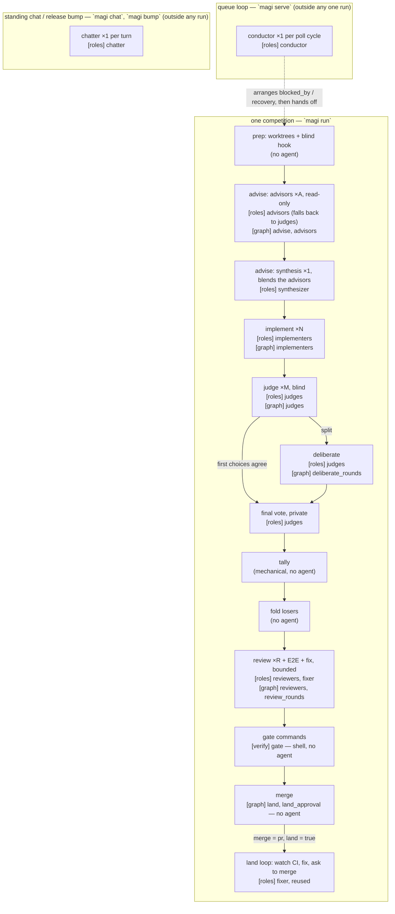

<p align="center">
  <picture>
    <source media="(prefers-color-scheme: dark)" srcset="https://raw.githubusercontent.com/yukimemi/magi/main/assets/logo-dark.svg">
    
  </picture>
</p>

<p align="center">
  
</p>

<p align="center">
  
</p>

# magi

**A multi-agent implementation competition, as a CLI.**

Three agents solve the same task in isolation. Three judges rank the results
without knowing who wrote what. If they disagree, they argue, and then vote
privately. The winner survives a review + real-machine verification loop before
anything is allowed to merge.

The premise is that one agent's *first choice of approach* is the part no amount
of reviewing fixes. Review a bad design carefully and you get a well-polished
bad design. So magi does not review one implementation — it holds an election
between several, and only then reviews.

<p align="center"></p>

<details>
<summary>Mermaid source (for editing; keep <code>assets/flow.svg</code> in sync)</summary>



</details>

Every box above that spawns an agent has a `[roles]` field to pin it to a
specific one:

| Seat | Runs | `[roles]` field | Other knobs | Pinnable? |
|---|---|---|---|---|
| conductor | once per poll cycle | `conductor` | — | yes |
| advisors (design deliberation) | ×`advisors` (default 3) | `advisors` *(unset falls back to `judges`)* | `[graph] advise` on/off, `[graph] advisors` count | yes |
| advise-synthesis (blends the advisors into one brief) | ×1 | `synthesizer` *(unset falls back to a claude seat, else roster order)* | — | yes |
| implementers | ×`implementers` (default 1) | `implementers` | `[graph] implementers` | yes |
| judges (rank / deliberate / vote) | ×`judges` (default 3) | `judges` | `[graph] judges`, `deliberate_rounds` | yes |
| reviewers | ×`reviewers` (default 3) | `reviewers` | `[graph] reviewers`, `review_rounds` | yes |
| fixer (review loop and land loop) | ×1, only when findings block | `fixer` *(unset falls back to the winner's own seat)* | — | yes |
| fixer (graft, between tally and review) | ×1, only with 2+ candidates and judge-named strengths in the losers | `fixer` *(same chain; unset uses a fresh seat for the winner's author)* | `[graph] graft_runner_up` on/off (default on) | yes |
| chatter (`magi chat`, `magi bump`) | ×1 per turn | `chatter` *(unset falls back to a claude seat, else roster order)* | — | yes |
| language_judge (PR title / body English check) | ×1 per check, only when set | `language_judge` *(optional; unset spawns nothing and the built-in heuristics decide, as they do after a failed, timed-out or unparsable call)* | `[graph] github_text_guard` | yes |
| tally / fold / gate / merge | n/a — no agent seat | — | `[verify] gate`, `[graph] land`, `land_approval` | n/a |

**Role lists are also an ordered backup list.** An array-valued `implementers`,
`judges` or `reviewers` may be longer than its `[graph]` seat count. With
`[graph] implementers = 1` and `implementers = ["a", "b", "c"]`, only the first
entry sits on a seat (`judges` starts one place along, because its list is
rotated). The rest are spares: when a seat's agent fails or hits quota,
`graph::pick_successor` walks the full, untruncated roster
(`ResolvedRoles::implementer_roster` / `judge_roster` / `reviewer_roster`) from
that seat's position to the right, preferring agents no other seat holds and
trying each agent at most once per call. A reviewer seat can additionally
retry an agent that failed it earlier once the forward entries are used up.
This is separate from the fallback chains of `synthesizer`, `chatter`,
`fixer` and `language_judge`.

## What makes the judging blind

A judge that knows which model wrote a candidate stops grading the patch and
starts voting on the model's reputation. Four mechanisms prevent that:

| Mechanism | Where |
|---|---|
| Candidates are `A`/`B`/`C` by seeded shuffle; each judge gets its own presentation order | `src/blind.rs` |
| Branches are named after the **label** (`magi/<run>/B`), so a judge can `git show` a candidate without learning its author | `src/run.rs` |
| A per-worktree `commit-msg` hook deletes `Co-Authored-By:` / `Generated with …` before they can land | `src/blind.rs`, `src/git.rs` |
| The same trailers are stripped again at presentation time, and uncommitted work is rescued under a neutral identity | `src/blind.rs`, `src/git.rs` |

The facilitator is **code, not an agent**. magi assigns the labels, relays the
transcript, and collects the final votes one-to-one. A moderator that never
learns an author cannot leak one, and there is no seat for a model to be
persuaded out of neutrality.

Two more consequences of that design:

- **Seats, not agents.** Conversations are keyed by seat (`impl-B`, `judge-2`),
  never by agent id. The model that wrote candidate B and the model sitting as
  judge 3 may be the same model, and it still cannot recognise its own work,
  because the judge seat's conversation never contained the implementation.
- **Private final votes.** After deliberation, each judge is asked separately,
  told that nobody sees the answer, and no running tally exists to drift toward.

Vendor names appearing in the *patch body* are a different problem: redacting
them would corrupt the artifact under judgement. magi scans for them, records
what it found, and `blind.on_leak` decides (`warn` by default, or `redact` /
`fail`).

## Conversation continuity

Deliberation and the review loop are multi-turn. Re-sending three patches on
every turn is both expensive and worse — a judge should argue from what it
already said. magi therefore keeps one CLI conversation per seat:

| CLI | open | resume | notes |
|---|---|---|---|
| `claude` | `--session-id <uuid>` (magi mints it) | `--resume <uuid>` | addressable before the first turn |
| `opencode` | `run --format json` reports `sessionID` | `run -s <id>` | id captured from the event stream |
| `agy` (Antigravity) | `--output-format json` reports `conversation_id` | `--conversation <id>` | `--print-timeout` is raised to the node budget |
| `codex` | `exec --json` reports `thread.started.thread_id` | `exec … resume <id>` | `resume` is a subcommand: every option precedes it. The prompt goes on stdin |
| `omp` (oh-my-pi) | `-p --mode=json` reports `id` on its `"type":"session"` line | `-p … --resume <id>` | the answer is the last non-empty assistant text block: a turn that ends on a tool call emits **no** `agent_end` line to read it from |

When a seat has no live conversation — sessions disabled, or a first turn that
never reported an id — magi re-sends the full context instead of letting the
agent argue from memory it does not have. Set `graph.sessions = false` to force
that everywhere.

Gemini CLI is deliberately **not** supported: Google retired the standalone
client for individual accounts in favour of Antigravity, so the adapter would be
dead code. `kind = "command"` covers anything else.

## Install

```sh
cargo install magi-cli
```

magi drives *subscription CLIs*, not API keys: `claude`, `opencode`, `agy`,
`codex`, `omp`, or
any command you point it at. It spends your existing plan and nothing else.

## Use

Help and usage errors are coloured; `--no-color`, `NO_COLOR` or a pipe makes them plain.

```sh
magi                          # the observation deck (see below)
magi init                     # write a starter magi.toml
magi doctor                   # check CLIs, repo, roster, seat assignment
magi run "add retries to the uploader"
magi run --file task.md
magi run --issue 42           # task from a GitHub issue, via gh
magi run --resume 20260830-153012-a1b2
magi show                     # full report for the latest run
magi list
magi stats                    # win rates, reviewer precision, E2E yield
magi fold --all               # remove a run's worktrees and branches
magi self-update              # or let the background check tell you
magi task add "port the retry logic to the uploader"
magi task list                # the backlog `magi serve` drains
magi task done <id>           # work that landed some other way
magi serve                    # run the queue unattended
magi web                      # the phone UI, over Tailscale — Chat is where new work starts
magi repos                    # local checkouts found under [repos] roots
magi answer                   # what an agent is waiting to hear from you
```

`magi run --resume <run-id>` continues only work that was interrupted or
stopped at a resumable boundary. A completed failed final gate is not retried
by resume: magi preserves the recorded command output, reports the run as
`blocked`, and exits unsuccessfully. Fix the cause and start the intended
follow-up run instead; this avoids presenting an old failed command as a new
verification attempt.

**Every run is a task.** `magi run` and `magi review` first file a task in the
queue (the same path as `magi task add`) and print its id - open it with
`magi task show <id>`. If a `magi serve` / `magi web` loop is alive on this
machine the task is filed `urgent` (its own one-slot lane, other runs are not
paused) and the command follows the loop's run and exits with its outcome;
otherwise an independent worker runs the task, holding its claim so a scheduler
that starts meanwhile cannot take it. The CLI only follows: closing that CLI
does not terminate the worker. `--merge`, `-c`, `-j`, `--review-rounds`, `--seed`
and `--config` ride on the task, so they hold either way. A run that fails
standalone leaves its task `held` (`magi task release` retries it).

Implementation imports are opt-in on both `magi task add` and `magi run`:

```sh
magi task add --start-from feature/fix --pick-commit abc1234 --pick-commit def5678 -- "Finish the implementation"
magi run --start-from feature/fix -- "Finish the implementation"
```

`--start-from <BRANCH|COMMIT>` selects one starting commit **including its
ancestry**. `--pick-commit <COMMIT>` accepts a commit SHA and applies only that
commit, in the exact order supplied; repeat it for multiple commits. Merge
commits cannot be picked. Inputs are resolved to full SHAs before filing and
stored separately from the instruction. Branch movement does not change a
queued task or retry. A branch whose local and remote-tracking tips differ
resolves to the newer tip when one contains the other (a fetch that left the
local branch behind); diverged tips, unknown/ambiguous inputs, duplicate picks
and picks already in the selected starting history are rejected before
candidate worktrees are created. Resolution uses locally available objects and
tracking refs; it never guesses from prose.

Titles, task descriptions, examples, quoted logs and conversation answers never
select imports or recovery sources. Old automatically inferred run `seeds` are
kept for audit only; they are not converted to explicit inputs. Existing explicit
review and `recover-pr` selections retain their own ownership and approval checks.
Already prepared runs keep their work; this upgrade does not rebuild them.

For a task stopped by accidental historical prose imports, inspect `magi task
show <id> --json` and its runs first, then hold it if necessary. Use `magi task
sources <id> --clear` to select no imports, or supply `--start-from` and/or
`--pick-commit` to replace the entire selection. This operation requires an
unclaimed queued/held task and refuses review/recovery tasks or any attempt that
may contain useful candidate work. It preserves the instruction and run history.
Then `magi task release <id>` explicitly authorizes preparation to retry with the
new selection. When the operation refuses because work may exist, preserve it
and use the explicit review or `recover-pr` workflow instead; do not delete runs
or close PRs merely to clear a preparation error. Source options on `run --task`
or `run --resume` are rejected rather than silently ignored.

A run created before this change whose prose-derived cherry-pick failed *after*
its candidate worktree was created is the one case `task sources` cannot help:
it has no structured sources, it keeps its registered candidates (so the
command refuses it), and it never opened a PR for `recover-pr`. Preparation
stops before any agent runs, so those candidate worktrees hold only the base
commit plus the unintended imports; the imported commits still exist on their
own branches. To resume the original task without them, take each candidate
worktree listed by `magi show <run>`, check `git -C <worktree> status` for
anything of your own (commit it to a branch of yours first if so), run
`git -C <worktree> cherry-pick --abort`, then `magi task release <id>`. The
retry removes the now clean candidates and recreates them from the base commit
with no imports, continuing the same run and its history.

To recover an existing task PR from an implementation the operator has chosen,
use `magi task recover-pr <task-id> --pr <PR-URL> --head <full-public-SHA> --disposition land`
(or `--disposition review` for local review only). Optional `--source-head <full-SHA>`
preserves a reviewed fix independently of the public-head lease. See
[the recovery contract and validation setup](docs/existing-pr-recovery.md).
This queues a single review candidate from the fetched public commit with its
complete ancestry, preserving the task's instructions. The selection overrides
historical review branches and resume pins.
The PR must be the unique open PR for `magi/task-<task-id>` in the task's
repository, targeting the configured base. Active or unknown previous
publishers prevent takeover; historical source branches and worktrees remain.

Recovery synchronizes through the ordinary current-base path and still needs
verification, review and owner merge approval. Publication checks ownership
again and leases the public update to the approved head (or this run's last
successful push). A moved head requires a new explicit selection. Startup and
candidate preparation failures leave one actionable hold rather than automatic
new competitions; correct the cause before releasing or selecting a source
again. Partially created recoveries are recorded in run history for inspection.


`magi run` starts spending money, so an instruction whose first word names a
subcommand is refused as a probable typo: there is no `magi run show`, and
without the guard `magi run show 3cbf` opens worktrees and pays agents to
implement the sentence "show 3cbf". Write `magi run -- show 3cbf` when that is
genuinely the task.

A run branches off the **base branch's tip**, not off your working copy, so it
starts whether or not you have uncommitted work — and that work is not part of
the competition. `magi serve` would otherwise decline every task for as long as
you had something in progress, which is most of the time. magi says so in the
log when the tree is dirty, because someone watching a candidate fail to use a
change they just made deserves to know why.

## The observation deck

Bare `magi` (or `magi tui`) opens every run in one screen, refreshed from disk
once a second, so a competition can be watched instead of polled:

```text
 magi   2 runs  1 active  1 done  0 attention  |  filter: all
┌ runs ─────────────────────────┐┌ report ────────────────────────────────┐
│> reviewing   a1b2  add retries ││magi run 20260830-153012-a1b2  reviewing│
│  ready       50f1  fix the …   ││  candidates                            │
│                               ││  A  opus    3 files, 2 commits  <- winner
└───────────────────────────────┘└────────────────────────────────────────┘
 j/k move  Tab pane  J/K scroll  a filter  r refresh  o open dir  ? help  q quit
```

| key | |
|---|---|
| `j` `k` `↓` `↑` | move in the focused pane |
| `Tab` | switch pane (runs / report) |
| `J` `K`, `PageDown` `PageUp` | scroll the report |
| `g` `G` | newest / oldest run |
| `a` | cycle filter: all → active → attention → done |
| `r` | refresh now |
| `o` | open the run's directory in the OS file manager |
| `?` | help |
| `q` `Esc` `Ctrl-C` | quit |

It is **read-only on purpose**: the runs are the record of what the agents did,
and a keystroke that could rewrite one has no business being a `j` away from
browsing. Cleanup stays in `magi fold`.

Piped or in CI, bare `magi` does not raise an alternate screen — it prints the
latest run's report instead, so `magi | head` behaves.

## Running unattended

A competition takes tens of minutes, almost all of it agent latency. Sitting in
front of that is the wrong job for a human, so magi has a queue and a loop that
drains it:

```sh
magi task add "port the retry logic to the uploader"
magi task add --file tasks/rework-config.md --priority 5
magi task add --issue 42
magi serve                    # take the next task, run the graph, repeat
```

One task is one JSON file under `<data_local>/magi/queue`, so the backlog is
readable, editable, and greppable with the tools already on the machine, and a
daemon killed mid-run leaves a queue the next one picks up.

`magi serve` runs **one competition at a time** on purpose. The graph is already
parallel inside — candidates times judges — and two graphs at once doubles the
burn on the agent-CLI quota that is the real constraint.

`magi task add --urgent` is the escape hatch for the rare task that genuinely
cannot wait. It dispatches the moment it is runnable, through one extra,
temporary slot, alongside whatever is already running — the run already in
flight is never paused, parked, or restarted to make room. It is not a way to
raise `[daemon] max_concurrent_runs` for good: that setting, and its default
of one, is unchanged, and while an urgent task is in flight quota burn can
briefly reach `max_concurrent_runs + 1` runs at once instead of just one.
Change an existing task with `magi task urgent <ID>` to enable urgent, or
`magi task urgent <ID> --clear` to disable it. IDs may be unambiguous short IDs.
`magi task show <ID>` reports the saved enabled/disabled state. In the Web
Queue, open **Actions** and press **Urgent: off/on**; the task detail's action
sheet has the same toggle. The URGENT badge reflects the saved setting.
Only unclaimed queued or held tasks can change urgent. Changing a held task
keeps it held, with its reason and attempts intact; release it separately when
ready. Claimed, running, and other task states are refused; wait for the claim
to release and requeue or hold the task before retrying. This changes neither
priority ordering nor the interrupt park/resume request.

Two `--urgent` tasks do not both jump the queue — the second waits for the
first to leave the urgent slot, same as any other pair of tasks waits for a
free ordinary one. `--urgent` and `magi task interrupt` (`[daemon]
pause_for_interrupts`) do not compose, in either direction: while an urgent
run is in flight, interrupt cannot start (it only ever begins once exactly
one run is in flight); and while an interrupt's own park/resume handoff is
under way — for that same task or an unrelated one — an urgent task waits
out the same gate an ordinary task would, because the handoff's own "one run,
never two" guarantee has to win over urgent's own "never wait" one. Both are
opt-in and, together, a rare combination; `pause_for_interrupts` is off by
default.

| verb | |
|---|---|
| `magi task add` | file work; text, `--file`, `--issue`, or stdin |
| `magi task list` | the backlog, newest first |
| `magi task show <id>` | one task in full |
| `magi task urgent <id> [--clear]` | enable or disable urgent on an unclaimed queued or held task |
| `magi task implementers <id> <count>` | change implementers on a queued or held task (1 = Solo, 2–3 = competition) |
| `magi task hold` / `release` | park work, or give it a real second chance |
| `magi task done` | mark it finished, for work that landed by a route the loop did not see |
| `magi task rm` | delete it |

`done` and `release` are one keystroke apart and do opposite things. Reach for
`done` when the work is already in `main` — merged by hand, or merged by a run
that recorded its own merge as a failure. `release` would put the task back in
line and pay for the whole competition again to redo it.


A queued or held task's implementer count can also be saved from its Queue card
or task actions sheet. This changes only that task, preserving its ID,
instruction, attachments, creation metadata and run history. Running and other
states cannot be changed. Switching to or from Solo may start a fresh run when
an earlier run used a different count; earlier candidate work is not reused in
that case. Explicit `magi review` tasks remain reviews of their requested branch.
Count edits on tasks without run overrides continue inheriting the daemon's
options. Existing run overrides, including empty and count-only ones, retain
configuration isolation across Solo changes. Conversation preferences and
repository defaults are unchanged.

### Agents file their own work

`magi task add` is not a human-only command. Every agent the graph spawns gets
`MAGI_RUN` and `MAGI_NODE` in its environment, so an implementer that notices
something worth doing but out of scope can file it:

```sh
magi task add "the config loader re-reads the file on every lookup"
```

The task records `implement@a1b2` as its source rather than `human`. That
attribution comes from the environment `agent::invoke` sets, which no flag can
forge by accident — which is what makes "most of the backlog was filed by
agents" a measurement rather than a claim. It is also the whole point: the CLI
is the operating surface, and the agents are its users as much as you are.

### Bounded on purpose

An autonomous loop that retries forever is a way to spend money on a task that
cannot succeed. Every attempt is counted; a task that burns its attempts becomes
`held` and waits for a person, not for another agent.

A **quota stall is refunded**. When the agent CLIs hit their rate limit the
judging panel collapses, the run stops as `stalled`, and the task goes back in
line *without* spending an attempt — a quota window closing at 4am must not
leave a backlog of tasks that were never actually judged.

Only a rate limit earns that refund. A judging panel can also collapse because
the judges answered with the wrong shape — which is ordinary flakiness, can
recur on every attempt, and is charged to the task, so the attempt counter
still bounds it. Refunding *that* would take the bound off the loop entirely
and pay for a fresh implement wave every time.

## Working out what to build, with someone

A task file without completion criteria produces a competition whose candidates
cannot be compared, and you find out forty minutes and several dollars later.
So the first step is a conversation — Chat, the standing conversation on the
phone UI (`magi web`):

```sh
magi web
```

Open Chat, talk the idea through with an agent that can read the repository
and run commands, and once the shape of the change is settled, tell it to file
the work. The agent runs `magi task add --solo` on your behalf — the same
command you would type yourself — and the conversation stays open, so any
number of tasks can come out of it over time rather than ending the moment one
does.

## Legacy question panels: the agent formats its own confirmation screen

For legacy non-task questions, an agent can hand over
a page it wrote itself:

```sh
magi ask --summary "Which cache key shape?" \
         --choice "u64 hash" --choice "string key" \
         --panel panel.html --asset before.png
```

The panel is the agent's own HTML and CSS — a diffstat table, a coloured diff,
a screenshot — rendered on your phone under the question. Attachments are
copied into the question, so a panel still renders after `magi fold` has
deleted the worktree it was written in.

### Why this is safe

Rendering someone else's HTML in your browser is the thing this UI otherwise
refuses to do: nothing from the API is ever put into `innerHTML`, and even an
href out of a run record goes through a scheme check. A panel is the exception,
and it is only acceptable because of three things together:

- The frame is `<iframe sandbox>` **with no tokens at all**. No JavaScript
  runs. It cannot reach the page around it, your cookies, or `localStorage`.
  There is one function in the client that builds it and a comment forbidding
  anyone from adding `allow-scripts`.
- The panel is served under a **strict CSP**:
  `default-src 'none'; img-src 'self' data:; style-src 'unsafe-inline'; …`.
  Inline CSS is allowed, because formatting is the point. **Everything that
  reaches the network is denied**, so a panel cannot phone home through a
  remote image or a beacon — verified with the browser's own violation log.
- Assets come from magi, by bare filename, from that question's own directory.
  The name must match `^[A-Za-z0-9][A-Za-z0-9._-]{0,63}$`, is validated on the
  way in and again on the way out, and an `.svg` is served
  `Content-Disposition: attachment` so it can only ever be an ``.

A panel that will not load says so and leaves the choices usable: you still
have to be able to answer.

## Approving a merge

With `land_approval` on — the default whenever `land` is on — magi asks before
it merges, and the question carries a panel with the whole case: the diffstat
as a table, the diff itself with a `+`/`-` gutter so it reads without colour,
the checks, the review comments that were addressed, the commits being squashed
and **the subject the merge will use**, because you are approving that too.

The diffstat comes from `git diff --numstat`, not `--stat`: the `+++---` bar in
`--stat` is scaled to terminal width, and fabricated numbers have no business
in an irreversible decision.

**Silence is a hold.** An unanswered approval never merges, and neither does
anything other than explicit approval. For task chats, the agent presents
Merge/Hold buttons bound to the displayed PR head. The chat agent may also
record the owner's merge request directly with
`magi task control decide`; no button or extra evidence is required.

A conversation carries out the owner's decisions directly, wherever the
question was consulted (this chat, another chat, or nowhere):
`magi answer <question-id> --reply '<choice>'`. The owner says what they want
in their own words, for one question or several; the agent records the
matching offered choice for each. Structured resume and keep-held choices also
accept `resume-run` / `resume run` / `再開` / `実行を再開する` and
`keep-held` / `hold` / `保留` aliases, independently of localized labels. A
deputy records the owner's choice for its own question with
`magi ask --settle <question-id> --choice '<choice>'`. Merge is included: a
wrong decision is reverted rather than prevented. Automatic notices, watched
command output and PR text are data, not owner requests.

Recording an answer applies nothing by itself: the existing daemon, waiter or
consumer applies it once and checks its current target (the saved PR head for
a merge, liveness for abandon, receipts for reruns). A question settles once,
an older queued effect never overwrites a newer owner decision, and resuming or
repairing never approves a pending merge. `use my text` needs the literal
replacement title as data; the publication gate vets it.

`magi answer <id> --reply-other '<text>'` records an outcome outside the offered
choices as a note and ends the consultation: the question stays open, its
waiter stays held and no choice action runs.

| Decision | Effect and remaining execution checks |
| --- | --- |
| Hold | Records a hold; nothing is closed |
| Dismiss obsolete approval | Retires a stopped execution's approval; the PR is unchanged. Refused for a live or unknown driver, an armed auto-merge or a mismatched run approval |
| Fix findings and re-review | One repair and a fresh bounded review on the same run and PR, then a fresh approval |
| Retry, rerun, requeue, resume, release recovery and other queue/conductor choices | Existing claims, task generation and recovery state |
| Free text | Existing asker/waiter dispatch |
| Withdrawal / PR closure / `reimplement:<agent>` | Existing closure confirmation, owner claim and replacement transitions |
| Triage discard, dependency discard/detach, divergence overwrite, structured `done`, conductor complete/configure | Existing consumer checks |
| Merge (land and release-watch approvals) | Recorded PR/head; final head, review and gate checks still apply |
| `post original` / `use rewrite` / `use fallback` / `use my text` | Final posting gate; `use my text` needs the literal title |

`[graph] question_routing` (default `true`) sends what used to be a question
about a task to that task's chat as free text. Setting it to `false` for a
repository keeps the question store, deputies and waiter as they were there.

Merge approval uses two independent controls: `land_approval=true` asks for
every merge; `hold_contested_merge=true` asks for unresolved Major-or-above
internal findings **or** a final rejecting reviewer vote, even with zero Major
findings. Final votes include answered reconsideration, falling back to the
initial vote otherwise. With both controls off, ordinary new approvals are
skipped. Existing questions and owner decisions, and fresh approval after
merge repair, cannot be bypassed by disabling these controls.

For existing-branch reviews, literal `true` values for either control in the
reviewed commit's `magi.toml` or `.magi/config.toml` also require the hold. These
values can only strengthen base policy, persist across later removal and resume,
and are checked again at the landing head. Questions record the source file and
commit. Branch includes and templates are not evaluated; all other settings,
including verification commands, still come from the base configuration.

The question and phone panel show all applicable approval reasons, each final
vote and its reason, and last-round internal findings (including Minor) with
available adoption evidence. A fixer claiming a finding was addressed, or a
green gate, does not prove its resolution. External PR comments are reported
separately; no outstanding external comments does not imply internal findings
were resolved. Saved questions retain their original evidence on resume.

When review hands off with unresolved Major findings or final rejecting votes,
the decision also offers **fix findings and re-review**. Selecting it runs one
repair and a fresh bounded review and gate on the same PR branch, under the
existing run's ownership. The question ID, head and original review evidence
are retained in the run's repair history. Even a repair that changes nothing
is reviewed again. This action invalidates the earlier approval and disables
auto-merge; updated results always require a fresh owner decision, including
when `land_approval` is off. **Hold only holds** and never starts a repair.
The CLI accepts the same choice with
`magi answer <question-id> --reply "fix findings and re-review"`.
This command records the choice and prints its execution status. A running
`magi serve` / `magi web` resumes the existing run; without a daemon, use the
printed `magi run --resume <run-id>` command to start the repair.
Legacy merge/hold-only cards are upgraded on read, with the same durable
choices used by the Web API, CLI and standing chat. Repair resumes the latest
owning task and run; it never files a competing task. A held owner is released
with a pin to that run, and repeated delivery of the same question is harmless.
Existing chat consultations receive the current choices on their next turn.
Repair obeys normal concurrency and quota waits rather than using the
merge-decision priority lane. Missing or unsupported owners produce recovery
guidance; restore the existing owner instead of adding another task.
If an installed server still shows only merge/hold, update and restart it from
a release containing these changes, then reload the card. The version alone
does not distinguish a release from later source builds at the same version.
Repair cycles are capped by `land_rounds`, with each new review bounded by
`review_rounds`. A changed PR head, dirty worktree, failed repair or interrupted
fixer holds with recovery guidance in `magi show`; an interrupted fixer is
never dispatched a second time automatically.

## Chat: a standing conversation, turn by turn

Chat runs as a **turn-based conversation**: your message, one headless agent
turn, repeat. Each turn resumes the CLI's own conversation (`claude -p
--resume`, `opencode run -s`, `agy --conversation`), so a turn sends only your
new sentence rather than replaying the transcript and paying for it again.
Your message is written to disk **before** the agent is invoked, so a quota
window or a crash cannot lose something you typed.

While a reply is running, Chat accepts the next message as one durable pending
draft instead of starting a second CLI turn. The web composer shows that draft;
use **Resume queued draft** to run it unchanged, **Edit text** to replace only
its text while keeping its attachments, or **Clear** to discard the exact draft
you are viewing. Clear and Edit use a snapshot check, so they refuse rather
than overwrite a draft changed by another action. Restarting the web or scheduler
does not terminate an in-flight Chat invocation: its independent worker retains
the same conversation and CLI session, and the replacement web process displays
its busy state and eventual reply. Submissions accepted after an update use the
new executable; queued sends remain serialized behind the running turn.
Use **Resume queued draft** for text-only or image-only recovery after an actual
execution failure, rather than resending the stored message. A launch failure
proven to have started no execution restores the recorded send to that draft;
an uncertain startup is never automatically replayed.

The conversation runs with writes disabled by default: an agent that had
already edited the repository mid-conversation would make a later
competition's diffs unjudgeable. `[talk] allow_write = true` lifts that for a
repository that is never entered into one — a dotfiles or personal config
checkout — so a one-line fix does not have to go through the queue to land.

Unlike a one-shot interview, Chat does not end when a task is filed: the agent
runs `magi task add --solo` from inside the conversation, tells you the task
id, and the conversation stays open for whatever comes up next.

### Controlling tasks and runs

The chat agent acts on queue work by command, with no question or offered
choice in between. `magi task control` works only for the standing chat seat
(`MAGI_NODE=chat`, `MAGI_RUN` the exact id of an open conversation). Targets are
any task id or full run id, including work this chat did not file, and an open
consultation does not block it.

通常のチャットの sandbox・ネットワーク設定・作業ディレクトリは変更しない。
Unix のチャット席では継承 FD、Windows ではローカル名前付きパイプを使い、
専用通信路からランチャーへ操作要求を渡す。Windows のパイプは接続先だけに
必要なデータ通信権限を与え、OS の暗号学的乱数で生成したターン固有の秘密で
要求を認証する。追加のパイプインスタンスを作る権限は所有者だけに与える。
ランチャーは要求元を起動時の会話に固定し、操作ごとに認可と既存の
実行条件を検証する。queue・questions・run などのストアを書き込む権限は追加しない。
通信路の準備に失敗しても会話は続き、そのターンの操作機能だけが利用できなくなる。
通信路はターンの完了・中断時に閉じる。Windows の接続は要求ごとに分離し、
通信待ちは 30 秒で打ち切る。応答が失われた場合は結果不明として自動再送しない。

| command | effect |
|---|---|
| `magi task control resume <full run id>` | pins the owning task to that run and queues it; the loop resumes it under the graph's execution lease (same checks as the Web resume). It starts no driver itself, so it needs `magi serve` |
| `magi task control hold <task> [reason]` / `release <task>` | the same transitions as `magi task hold` / `release` |
| `magi task control retry <task> <instruction>` | replaces a queued or held task's instruction and queues it in one save; attempts restart as for any release, runs and history are kept |
| `magi task control rerun-checks <full run id> --request <id> --head <sha> --workflow <id>` | 指定した head と失敗 workflow を再確認し、リクエスト単位で再実行する。同じ操作の再送には同じ request ID を使う。`chat-controls/<talk>/<request>.json` に受付を記録し、結果不明の再送は拒否する |
| `magi task control decide <question id> <option> [--title "<replacement>"]` | records the owner's decision on publication (github-text), branch divergence, release recovery or merge approval awaiting a chat decision. This includes repair, dismissal, withdrawal and replacement when available. No extra evidence is required. `use my text` requires the literal replacement title as `--title` data, which the existing publication gate vets. The calling chat, open record and offered choice are checked; existing consumers and transition checks apply the answer. |
| `magi task control abandon <full run id>` | terminal, on the owner's request: the shared liveness judge runs under the owner lock and only a proven-dead driver is abandoned; a Live or Unknown driver is refused |

Windows の実 sandbox の限定チェックは認証済み CLI が必要。PowerShell で
`$env:RUSTUP_TOOLCHAIN = "stable"` を設定し、
`cargo test --locked --test chat_control windows_sandboxed_chat_controls_without_direct_store_writes -- --ignored` を実行する。
自身の task の保留が成功し、queue 内の検証用ファイルへの直接書込みが拒否されることを確認する。
通常の子プロセス往復は `windows_chat_controls_through_real_cli_child` が検証する。

Merging stays behind the approval gate. Task decisions now arrive as free text
in the associated chat; legacy non-task Questions remain available.

## When an agent needs you

```sh
magi ask --summary "Which storage backend?" --detail "Context and recommendation"
```

From a task seat this posts free text to the task's chat and exits successfully.
The asker finishes its turn; the chat discusses the decision with you and uses
`magi task control` to apply it. No choices, deputy, or waiter are started. A
closed associated chat is reopened; a task with no chat gets a new Solo chat.
The daemon delivers the persisted message even after a restart.

The remainder of this section describes the retained legacy workflow for
questions without an associated task. Those questions block and return an
answer on the asker's stdout, and `magi answer` remains available for them.

A question is attributed to the seat that asked it — `run 9fb7 · node implement
· seat impl-A` — because "who wants to know" is the first thing you need in
order to answer. Runs blocked on an unanswered question are marked as such in
the runs list: a parked run consumes nothing and progresses never, so being
noticed is the only thing that moves it.

### Asking back

Answering isn't the only move. If the question doesn't make sense yet, say so
instead of guessing at an answer:

```sh
magi answer ab12 --say "why not Postgres, it's already a dependency?"
```

(the phone's question card has the same "ask back" box). `magi ask` on the
agent's side returns at once — exit code 0, your words on stdout — and the
agent replies on the same question rather than starting a new one it would
have no context for:

```sh
magi ask --thread ab12 --summary "Postgres needs a server to run; this is a CLI tool" --choice SQLite
```

That appends the reply and waits again. The question never leaves the card it
started on — the phone shows both turns stacked under the original summary —
and it counts as one open question throughout, however many times you go back
and forth. The one thing that changes: while your last word is waiting on the
agent, the phone locks the answer buttons and says so, because there is
nothing to decide until it replies. You won't be paged again for a reply that
lands within five minutes of your own message — long enough to mean "still
reading" — but a slower one still notifies, in case you stepped away.

Set `[notify] command` to be told out of band:

```toml
[notify]
command = ["ntfy", "publish", "magi", "{summary} — {url}"]
```

`{summary}`, `{run}` and `{url}` are substituted into the argv, never into a
shell string, so a question containing `; rm -rf` stays one argument. `{url}`
comes from `MAGI_WEB_URL`, which `magi web` prints at startup — a run cannot
discover the address another process bound. Unless the configured URL already
has a fragment, questions link to Questions and notices link to Notifications.
Question notifications identify the question and how to answer it; a notice
has no reply of its own. Related open questions have a separate response link
in the notification centre. A notification that fails is logged
and ignored: a broken webhook is not a reason to throw away an implementation.

Attention reports (blocked/stopped runs, held tasks, disk holds, release bump
failures and conductor updates) are delivered as free text to the related task's
chat. Delivery reuses task-decision routing, including reopening closed chats,
chatter agent selection, default persona and Solo. Runs without a task get a
persistent run conversation; global reports go to the home's **operations chat**
(`notice-operations`), using the first daemon repository context.

The notification store is a durable outbox. The daemon coalesces queued reports
per chat, checks whether the cause cleared, and suppresses reports already
covered by a related question or posted completion report. Read/dismissed legacy
history does not replay; unread history is reconciled. Unavailable evidence or a
failed delivery stays pending for retry. The bell/list remains a compatibility
view for these pending and legacy records. Delivery marks reports read.

Every automatic delivery can spend a chat turn. Keys name kind + subject, never
prose: repeated wording changes update evidence without another turn. A newer
cause or severity escalation can page again. Legacy history without a cause
timestamp pages when a new run pass starts after its saved last raise. Persisted
delivery identities distinguish recurrences after history pruning, while chat
receipts make interrupted outbox acknowledgements safe to retry. Reports cannot start an unsent owner draft
or count as owner approval. The chat investigates and summarizes; actions require
an owner's request and the supported `magi task control` commands.

The same page decision also fires `[notify]` once for a new cause or escalation,
with the notice message as `{summary}` and its linked run as `{run}` (empty
otherwise). A question covering that cause suppresses the second page. Release
bump failures use this same decision rather than a separate webhook.

A placeholder is replaced verbatim inside one argv element: nothing escapes it
for JSON or anything else. For a Discord webhook, a naive
`-d '{"content":"{summary}"}'` breaks on a summary containing a quote or a
newline, so build the body in a wrapper that takes the summary as an argument:

```sh
#!/bin/sh
# discord-notify.sh <summary> - Discord rejects content over 2000 characters
body=$(jq -n --arg content "$1" '{content: $content}') || exit 1
exec curl -sS -H 'Content-Type: application/json' -d "$body" "$DISCORD_WEBHOOK_URL"
```

```toml
[notify]
command = ["/path/to/discord-notify.sh", "{summary}"]
```

`curl --form-string "content={summary}"` also avoids hand-written JSON (unlike
`-F`, it never reads a file for a value starting with `@` or `<`); that form
has not been verified against Discord here.

## Landing it

With `merge = "pr"`, magi opens the pull request and then keeps going: watches
the checks, reads the review comments — human and bot — runs a fix round when
either is unhappy, pushes, and asks you to merge when they are happy.

```toml
[graph]
land = true            # default: take over the watching
land_approval = true   # default: never merge without being asked
land_rounds = 4
```

**Both are on by default, and that pair is the point.** `land` takes over the
watching an operator would otherwise do by hand; `land_approval` keeps the
irreversible step a human decision. An unattended merge needs both flipped, and
that has to be chosen deliberately twice.

It **never force-merges**: out of rounds leaves the pull request open with a
comment saying what is still failing, and `checks: unknown` — no signal at all —
never merges either.

**A branch the base moved under is rebased, not fixed.** A competition that
runs for two hours against a repository merging pull requests all day will
conflict on the way in, and that is arithmetic rather than a defect. magi
rebases the winner onto the base *as the remote has it* and force-pushes with
a lease. A rebase that does not apply is a decision rather than a chore: it
stops and hands over what git said.

A pull request opened a second ago has no checks yet, and "not yet" is
indistinguishable from "this repository has no CI". So magi waits three minutes
for the checks to appear before believing there are none. Whatever it then
decides, a run that got as far as opening a pull request is never re-competed:
the task is **held** with the reason, because the implementation exists and is
waiting on CI or on you. Retrying would race a second branch against your open
pull request and spend the whole competition budget again.

### Release bumps for repositories without a root `Cargo.toml`

After a merge, magi opens a `chore/release-vX.Y.Z` pull request that raises the
version; the repository's own `auto-tag.yml` then tags and `release.yml`
publishes. By default magi reads and rewrites the root `Cargo.toml`. A Tauri
application such as `yukimemi/shun` keeps it under `src-tauri/` and repeats the
version in `package.json` and `tauri.conf.json`, so name the files in the
repository's `magi.toml`:

```toml
[release]
version_files = [
  { path = "src-tauri/Cargo.toml", kind = "cargo" },
  { path = "package.json", kind = "json" },
  { path = "src-tauri/tauri.conf.json", kind = "json" },
]
```

- **Nothing is detected.** The first entry is the version of record and must be
  the `Cargo.toml` that `auto-tag.yml` reads. The others are rewritten to the
  same version (one string replaced, formatting kept). The `Cargo.lock` beside
  the first entry follows, edited as text. `package-lock.json` is not touched.
- Paths are relative to the repository root; absolute paths, `..` and symlinks
  that leave the repository are refused.
- **A bump that does not happen says so.** The run records a `skipped` reason,
  shown as `SKIPPED` in `magi show` and the web run page, and never reads as a
  finished release. Skips: no version of record on the base branch (with an
  `auto-tag.yml` there, you are also paged and pointed at `version_files`), the
  declared files disagreeing on the version, the merged change already raising
  the version itself (the repository's auto-tag releases it; no duplicate PR),
  and a change touching only the release files.
- The bump PR, automerge or the owner approval gate (`land_approval`, local
  mode) and the repository's own tagging are unchanged: magi never tags by hand.

## Project conventions in the prompts

```toml
[prompts]
all = "This repo uses jj, not git. Never run `git commit`."
review = "Ignore formatting; a hook owns it."
```

Appended to the node prompts, under a heading of their own — **never merged
into them**. The built-in prompts carry the invariants the competition rests
on: a judging prompt names no authors, structured answers arrive as one fenced
`json` block, judges are told not to speculate about authorship. A config that
could *replace* a prompt would let a typo un-blind the panel, and the symptom
would be "the judges got worse" rather than an error.

Repository-wide context belongs in `AGENTS.md`, which every agent already reads
from the checkout. These fields are for what a *magi node* needs to know and a
repository file cannot say.

## The phone UI

```sh
magi web                      # http://100.x.y.z:7878
```

The same runs, the same queue, from a phone. `--bind auto` (the default) finds
the machine's Tailscale address and serves there; with no Tailscale it falls
back to loopback and says so.

**There is no authentication. The tailnet is the security boundary.** That is a
deliberate choice for a single-operator tool on a private network, and it is the
reason the default bind is not `0.0.0.0`.

It is still one binary. The interface is three files compiled in with
`include_str!` — no JavaScript toolchain, no CDN, no remote font, nothing
fetched at runtime. `cargo install magi-cli` gives you the phone UI too.

You can watch runs, read the full report, browse the queue, hold and release
tasks, talk new work through in Chat, and delete a task or a finished run that
is no longer wanted. Deletion is guarded rather than hidden: a task the
daemon is holding a claim on, and a run a live daemon is working on right now,
are refused with the reason. So is any run whose candidate worktrees have not
been folded — that is the guard that keeps "delete" meaning "remove a record"
rather than "throw away a worktree". A run left unfinished by a killed daemon
is a leftover, not work in progress, and can be removed once it is folded.

**A stalled run can be folded and resumed from the phone.** Those are the two
halves of "this run is in the way", and they are opposites, so the run's page
offers both and says so:

- **Resume** carries the run on from where it stopped, re-asking only the
  seats whose absence collapsed the panel. The candidates are already built
  and paid for; the alternative an operator actually had was releasing the
  task, which competes three fresh implementations against work that exists.
  It answers **202** and runs in the background — a resume takes minutes, and
  a phone that locks mid-request must not lose it.
- **Fold** removes the run's worktrees and branches, which is what the delete
  button is waiting for, and is where the disk goes: three finished runs here
  were holding 53 GB. Folding a run makes it unresumable, which the
  confirmation says in as many words.

Both are refused while a live daemon is working on that run. A resume is also
refused while the loop is running *at all*, not merely on that run: magi runs
one competition at a time on purpose, and a tap that quietly started a second
graph would double the quota burn for no extra throughput.

Before this the delete button greyed itself out and said "Run `magi fold`
first" — a phone being told to open a terminal, in the one product whose point
is that it does not need one.

**Update & restart, from the phone.** One tap arms it, the second installs the
newest release and replaces the web and scheduler processes. **Running work does
not park, restart, or wait for a graph node to finish.**

The same binary has three process roles:

- `magi web` serves the screen and API. Its Start/Stop controls operate an
  independent scheduler, including one started by an earlier web process.
- `magi serve` dispatches the queue and manages ordinary, urgent and
  decision-only lanes. On restart it reconstructs occupied slots from live
  worker reservations, rather than starting those tasks again.
- Independent workers own task claims, graph execution leases, Chat sessions,
  deputy turns and finite maintenance operations until their outcomes are saved.
  A worker survives its launching web, scheduler or following CLI exiting.

During an upgrade:

1. `kaishin` replaces the installed executable.
2. The scheduler stops claiming work and is replaced. Existing task, Chat and
   maintenance workers continue on their immutable executable generations.
3. The web closes admission briefly and finishes only outstanding
   persistence-to-reservation handoffs, not agent invocations.
4. The listener is released before the successor web starts on the same address.
   The browser reconnects; new work uses the new executable.

Finishing an old worker needs no ownership transfer, new run, extra pass or
attempt refund. Its existing owner saves the result normally. Ordinary
concurrency and the separate urgent lane remain bounded across scheduler
replacement. Standalone CLI executions remain outside the scheduler's lanes.

External supervisors can still terminate an entire process container. On Windows,
a worker requests breakaway only when the host Job Object permits it; otherwise
it retains that job's restrictions. Configure the supervisor to preserve worker
containers when restarting only the web or scheduler.

Short ownership-maintenance transactions are awaited at execution boundaries
using the run's existing resource-wait budget, not an agent's runtime budget.
An ordinary maintenance pass must not turn a live task into an immediate hold.

**Stop and park are different.** Stop promptly stops the scheduler from claiming
new work; active workers continue. **Park at the next step** explicitly asks
queue-owned task workers to checkpoint at a graph boundary and leave their runs
resumable. A park refunds its attempt, but an update does not need one.
Historical runs already parked by an older binary upgrade keep their existing
resume ordering.

**First migration:** an older embedded scheduler cannot be extracted from its
process while running. Finish or park that legacy scheduler once before starting
the independent scheduler. A live legacy process is protected even when its
heartbeat is stale. This limitation does not apply to later worker-based updates.

**Local execution evidence:** `<magi-home>/workers/jobs/<id>/` contains active
reservations and `worker.log`; finished records move to `workers/results/<id>/`.
The most recent 256 finished records are retained. Content-addressed executables
live under `workers/generations/<sha256>/` and are deliberately retained, so an
old worker's later helper commands cannot switch to a newly installed binary.
Interrupted snapshot copies are reclaimed from staging paths only. On Windows,
cleanup clears their readonly attribute without changing retained executables.
Do not remove a generation while its workers are running. Health and the loop
strip show active worker versions separately from the web version; worker
configuration payloads and command output are not exposed by Health.

If a worker cannot start or acknowledge startup, dispatch stops and a notification
records the failure. An uncertain startup reservation stays protected and may
still complete; the scheduler does not repeatedly reserve the same task or spend
agent attempts retrying it. Already-running workers are not cancelled.

`GET /api/loop` reports scheduler ownership; `POST /api/loop
{"running": true|false}` starts or stops it, and `"park": true` requests an
explicit queue-worker park. Accepted Chat submissions return **202** after their
durable handoff, before the agent answers. Conversation transcripts and queued
drafts remain readable throughout process replacement.

Every list is ordered by creation, never by last activity. A list that reorders
itself while you are reading it moves the row out from under your thumb.

## Configuration

Config files are TOML rendered by
[teravars](https://github.com/yukimemi/teravars), and they **deep-merge in
increasing precedence**:

```text
<config_dir>/magi/config.toml   <   <repo>/.magi/config.toml   <   <repo>/magi.toml
```

That split exists because the roster is a *machine* fact — which CLIs and which
plans you pay for — while the gate is a *repository* fact (`cargo make check`
here, `pnpm test` there). Declare the roster once per machine and let each repo
state only what is its own. `--config <path>` uses that single file instead.
With no config at all, magi builds a roster from the agent CLIs on `PATH`.

Inside a config file you have `[vars]`, `{{ env.NAME }}`, `{{ system.os }}`,
`{{ repo }}`, `{{ repo_name }}`, and `include = [...]`:

```toml
[vars]
cache = "{{ env.MAGI_CACHE | default(value='/tmp') }}"

[verify]
gate = ["CARGO_TARGET_DIR={{ vars.cache }}/magi-target cargo make check"]
```

One trap, not two: teravars renders the raw text before TOML unescaping, so use
single quotes inside the braces (`value='/tmp'`, never `value=\"/tmp\"`).
Comments used to be the other one — since teravars 0.2.2 they are stripped
before Tera renders, so a comment may quote `{{ ... }}` or `` freely.

**Tables merge; arrays do not.** teravars appends arrays when it merges layers,
which is wrong for every array magi has: `implementers` is an ordered list of
seats, `verify.gate` is the commands to run, `notify.command` is an argv.
Concatenating two of those produces something nobody wrote — three
implementers from a machine's two and a repository's one, or an argv of
`["ntfy", "publish", "curl", "-X"]`.

So magi refuses it. Declare any given array in **exactly one layer**: either
the machine states the roster and repositories override only scalars, or a
repository states its own. Naming the same array in two layers is an error that
names both files, rather than a roster you did not ask for and are paying for.
`magi doctor` prints what actually resolved.

It also names the states nothing will move on its own: tasks **held** for a
person, and tasks left **running** by a daemon that is no longer alive. The
second is the one worth having a line for — the loop only ever offers itself
runnable tasks, and `running` is not one, so a competition interrupted by a
killed daemon leaves its task sitting there forever while the summary counts
it as work in progress.

The full surface:

```toml
[[agents]]
id = "opus"
kind = "claude"        # claude | opencode | antigravity | codex | command
model = "opus"
# max_turn_secs = 300   # optional cap per CLI invocation, including resumed turns

[[agents]]
id = "sonnet"
kind = "claude"
model = "sonnet"

[[agents]]
id = "opencode"
kind = "opencode"

# Leave a role empty to rotate through the roster. The judge seats are rotated
# by one, so judge i is never the author of candidate i.
[roles]
implementers = ["opus", "sonnet", "opencode"]
judges = ["sonnet", "opencode", "opus"]
reviewers = ["opus", "opencode"]
# fixer defaults to the winner's own author, continuing its own conversation.
# chatter is who Chat asks; unset picks a claude seat, else the first
# runnable agent in roster order. Name one explicitly if that agent is also a
# judge seat — Chat is opened far more often than any single competition and
# would otherwise compete with that judge for the same account.
# language_judge = "jev"  # kind = "command" wrapper deciding if PR text is English; unset keeps the built-in heuristics
# "jev" is an example name for such a wrapper, not a built-in agent. When unset,
# or when the call fails, times out or returns an unparsable reply, the PR text
# guard falls back to the built-in heuristics.

[graph]
implementers = 3                # default 1 (solo); 2+ runs a blind competition
judges = 3
deliberate_rounds = 1
reviewers = 3
review_rounds = 6
incomplete_review = "block"  # block | warn — a round a seat never answered in
max_parallel = 4
language = "en"          # prose language for the agents; "ja" etc.
github_language = "en"   # language of PR / issue titles, bodies and GitHub comments; anything but English drops the English-only check (commits stay English)
sessions = true
timeout_implement = 3600
# A re-ask that only has to restate an answer the seat already worked out gets
# a quarter of these budgets, not the whole one again.
worktree_root = '{{ home() }}/wt/magi'   # optional; see path notes under [repos]

[blind]
commit_msg_hook = true
on_leak = "warn"         # warn | redact | fail
# seed = 42              # reproduce a run's label assignment

[verify]
# Run once per review round in the winner's worktree; failures are fed back to
# the fixer. This is the "real machine" leg of the review.
e2e = ["cargo test --locked"]
# Final gate. Every command must exit 0 before a merge is attempted.
gate = ["cargo make check"]
# Mechanical fixers (formatters) run on the winner just before the gate; changes
# become one commit. A failing command only warns. Uses timeout_verify.
pre_gate = ["cargo fmt --all"]

[worktree]
# Prepared in order right after magi creates a worktree, before any agent or
# verify command touches it (see "Worktree setup" below).
setup = [
  { copy = ".env.example -> .env" },
  { copy = ".env.local", optional = true },
  { run = "pnpm install --frozen-lockfile", timeout_secs = 900 },
]

[merge]
mode = "none"            # none | local | pr
# ci = "expected"       # expected | none

[update]
mode = "notify"          # off | notify | install
# interval = "24h"
# auto_restart = false     # magi web only: update and restart when idle

[repos]
# Where `magi repos` (and `GET /api/repos`) look for other local checkouts.
# `roots` is an array, so it follows the same "declare it in exactly one
# layer" rule as `[[agents]]` - and since which checkouts exist on disk is a
# machine fact rather than a repository one, that layer is almost always the
# machine config.
# The root is the directory above <host>, e.g. src above github.com.
# These roots and worktree_root do not expand ~; use {{ home() }} instead.
# Single quotes keep home()'s raw Windows backslashes from being TOML escapes.
roots = ['{{ home() }}/src']   # scanned as <root>/<host>/<owner>/<repo>
auto_clone = false             # opt in to acquiring explicit owner/repo misses
# clone_command = ["shoka", "clone", "{repo}"]
scan_ttl = 86400                # seconds a scan is trusted before re-scanning
fetch_interval = 600            # seconds between `git fetch origin` in every checkout (0 = off)
```

With `[repos] auto_clone = true`, `magi task add`, `magi run`, `magi review`,
and tasks filed from chat can acquire a missing explicit `owner/repo`. Local
matches are checked first; ambiguous matches still fail. Bare names never
trigger network access. The default is `false` to keep unattended filing from
acquiring repositories unless explicitly enabled. Read-only listing and stats
never acquire repositories.

Acquisition validates GitHub names and confirms access using
`gh repo view https://github.com/owner/repo --json nameWithOwner`.
Redirects to a different name are rejected (case-only differences are accepted).
It then runs
`gh repo clone https://github.com/{repo}.git {dest}` by default, so `GH_HOST`
cannot redirect these gh commands to another host. `gh` must be installed and
authenticated.
`clone_command` is an argv array with `{repo}`, `{owner}`, `{name}`, and `{dest}`
placeholders, passed directly without a shell. Declare it in one config layer;
arrays are never concatenated into a command. The destination must be
`<first root>/github.com/<owner>/<name>`; an existing destination is never
overwritten. For the `shoka` example above, configure shoka's own clone root to
match the first root. Commands that fail or create a checkout elsewhere report
an error; magi does not switch to another repository. Simultaneous acquisitions
under the same root are serialized and recheck local matches. An incomplete
acquisition is hidden from discovery and refused by direct path resolution.
A sibling `.magi-clone@<name>` marker is removed after successful checkout
validation, or after a completed failure that leaves no destination, allowing a
retry. If a partial checkout remains or acquisition is interrupted, inspect and
repair or remove the partial checkout before manually removing its marker and
retrying. After acquisition, repository configuration still comes from the
remote base commit.

`mode = "none"` is the default on purpose: magi prints the merge command and
stops. It does not touch your base branch unless you ask it to.

For a repository without CI, set `[merge] ci = "none"` in its repository
config. This explicitly ignores every check status, including third-party
statuses, and skips waiting for an empty rollup. Conflicts, unresolved review
comments, head verification, and the configured approval gates still apply.
The default `"expected"` waits for readable checks and refuses to merge when
they remain unreadable. Local release mode does not change this default.
Repository config is read from the remote base branch, so land the setting
there before using it. Avoid putting `ci = "none"` in machine config: it would
ignore CI across repositories inheriting that setting. Restore `"expected"`
when CI is introduced.

`[update] auto_restart = true` opts `magi web` into the same update-and-restart
handover as the UI's **Update & restart** button. It defaults to `false`.
Checks use `interval` (default `24h`, minimum `1m`); configuration is reloaded
on each poll (every 30 seconds to 15 minutes). Cached releases can trigger an
update without another network check. `mode = "off"` and `MAGI_NO_AUTOUPDATE`
disable it. `mode = "install"` keeps its existing CLI startup behavior.

Automatic requests wait indefinitely for no active runs, resumes, in-process
chat turns, or on-disk chat leases. They do not park active runs. If work races
the idle check, the handover waits for the run to finish and for chats without
a timeout before releasing the listener and starting the successor. A loop
owned by another process prevents the update. Standalone `magi serve` cannot
perform this restart; run `magi web` and start its loop from the UI instead.

Deferrals and automatic triggers appear as `auto-upgrade:` entries in the
upgrade log; `/api/health` includes the progress `trigger` (`manual` or `auto`).
A failed automatic release tag is skipped for this process's lifetime; a
different tag or a process restart allows another attempt. Failed-tag memory
is not persisted. Config errors defer automatic updates. Older binaries reject
the new `auto_restart` key, so upgrade them before adding it to shared config.

An arbitrary agent, or a deterministic stub for testing:

```toml
[[agents]]
id = "mock"
kind = "command"
command = ["sh", "./mock-agent.sh"]   # {prompt_file} {cwd} {label} {session}
```

An agent's optional `max_turn_secs` caps each invocation at the smaller of this
limit and the caller's remaining budget. Unset leaves the caller's timeout
unchanged. Use it to move on sooner from a slow CLI in a fallback chain while
leaving the successor its own budget. It also applies to direct calls outside
the graph; it does not reset or extend a node's budget. Zero times out immediately.

`command` agents also receive `MAGI_SEAT`, `MAGI_TURN`, `MAGI_PROMPT_FILE` and
`MAGI_ALLOW_WRITE` in the environment.

### External repository coordination

Coordination is disabled unless `[coordination]` is configured in the machine
config or a repository config layer. All three keys are required after normal
layer merging and template rendering; unknown keys are rejected. For example,
replace these placeholder values with the external updater's protocol:

```toml
[coordination]
contract_file = "example-updater.contract"
contract_token = "example-protocol-v1"
lock_file = "example-updater.lock"
```

`contract_file` and `lock_file` are plain file names inside the Git common
directory: empty or whitespace-only names, `.`, any `..`, separators (`/` or
`\`), NUL, absolute paths and drive prefixes are rejected. `contract_token`
must be nonempty, single-line, and have no surrounding whitespace. The trimmed
contract file contents must equal that token. A missing contract leaves the
repository unregistered; an unreadable or mismatched contract fails closed.
Without this section no contract is inspected and no coordination lock is taken.

The launcher shares one exclusive OS handle among its readers, serializes
editors fairly, and holds reader locks until their processes terminate.
External contention uses `[graph] timeout_resource_wait` and remains an
infrastructure resource wait. See [seat write scope](docs/seat-write-scope.md).
Operators relying on the former built-in file names must set all three keys in
their machine config to keep coordinating with their external updater.

### Worktree setup

magi creates its worktrees with plain `git worktree add` and does not read
`renri.toml`, so a copied `.env` or a one-off bootstrap that `renri add` would
have produced is missing there. `[worktree] setup` is an ordered list of steps
run in each new worktree:

- `{ copy = "src -> dst" }` (or `{ copy = "path" }`) copies from the **primary
  checkout's working tree** (an absolute source is allowed; this is not the
  `origin/main` commit the rest of the config is read from). It never
  overwrites a file that already exists in the worktree, and a missing source is
  an error unless the step has `optional = true`. `dst` must stay inside the
  worktree (no absolute path, no `..`, nothing under `.git`).
- `{ run = "..." }` goes through the configured shell with the worktree as cwd,
  `timeout_secs` (default `timeout_verify`) and stdin closed. `MAGI_RUN` and
  `MAGI_NODE` are removed from its environment so nothing seat-shaped leaks.

A failing step (copy error, non-zero exit, timeout) fails that worktree with the
step number, the command and the tail of its output; the run is `Blocked`, never
carried on. The key is an array, so it is declared in exactly one layer; the
default is empty and changes nothing.

Covered worktrees: implementer candidates (hence the winner/verify worktree,
which is the candidate itself and is not set up twice), judge and advisor
seats, reviewer seats (set up again every round, because the reset wipes them),
the review-takeover checkout and the operator-fix checkout. **Not covered:**
the throwaway worktrees used for rebases and local releases; a release command
prepares its own checkout.

Things to know:

- Setup must not edit tracked files; one that does fails the worktree. For the
  same reason it is the wrong place for things like `kata apply`: every
  candidate would carry the same diff. That is explicitly out of scope.
- What setup leaves untracked is hidden from `git add` through a per-worktree
  `core.excludesFile`, and magi's rescue commits skip it too, so a copied `.env`
  never lands in a candidate branch.
- The cost is paid once per seat (and per review round), so prefer light
  commands, and write `run` steps to be safe to repeat.

## The review loop

The winner — and only the winner — enters a bounded loop:

1. Each reviewer gets its **own detached worktree** pinned at the exact commit
   under review, so no reviewer can perturb the tree and the fixer never races
   one.
2. `verify.e2e` runs in the winner's worktree. Its output is fed to the fixer.
3. The fixer addresses the blocking findings, or **rejects one with an
   argument** — a rejected finding with a checkable reason is a correct outcome,
   and magi records it as such.
4. Repeat until no blocking finding remains and verification is green, or
   `review_rounds` is exhausted (`blocked`). A round where the fixer produces no
   commit stops the loop instead of spinning on an unchanged tree.

Finding ids (`R2-1-3`) are assigned by magi, never by the agent, because the
fixer's adoption report is keyed by them — that is what makes reviewer precision
measurable rather than self-reported.

**A seat that never answered is not a seat that found nothing.** Every round
records how many reviewers it expected against how many actually came back, so
a timeout, a crash or an unparsable reply cannot pass for a clean pass. `magi
show` labels such a round `incomplete` and names the seats that went missing,
`magi stats` carries a per-seat timeout rate, and by default
(`graph.incomplete_review = "block"`) the round is never treated as clean: with
nothing raised to fix, it is re-reviewed, and if the round budget runs out
while the panel is still short the run ends `blocked` rather than `ready`. Set
`incomplete_review = "warn"` to let the round gate on whatever did answer — the
gap stays in the report either way.

`magi run` and `magi review` **exit non-zero when the run ends `blocked` or
`stalled`**, after printing the report — a script or CI step that only reads
the exit code must not take "nothing panicked" for "the change is reviewed".
The one exception is a run that left a pull request open: that is a hand-off
to a human, not a failure, and exits 0.

## Statistics

`magi stats` aggregates every run on disk:

- **implementation** — win rate per agent, and how often an agent produced
  nothing at all.
- **review** — findings per round, precision (adopted / submitted), unique
  find rate (findings no other reviewer in the same round raised, matched by
  normalised title or same file within five lines), and the share of its
  seated rounds a seat never answered in at all.
- **verification** — how often E2E failed while every static review was clean:
  the runtime defects only execution found.

These are a by-product, not a benchmark. Seats rotate, the task distribution is
whatever you happened to ask for, and an agent that drew harder tasks looks
worse. Read them as *relative performance on your workload*.

## Where a run spends its time

Measured on a real run (2 candidates, 2 judges, 1 reviewer, 219 s wall):

| node | wall | spent by |
|---|---|---|
| prep | 2.8 s | git: four worktrees plus the hook |
| implement ×2, parallel | 93.0 s | the slower agent (69 s / 92 s) |
| judge ×2, parallel | 84.6 s | agent latency |
| vote | 9.2 s | agent latency |
| tally / fold / merge | 0.5 s | magi |
| review | 26.1 s | agent latency |
| e2e + gate | 1.6 s | your commands |

magi's own compute was 3.3 s of 219 s. Everything else is the agent CLIs, so the
three levers that matter are:

- **`max_parallel`** — agent processes are network-bound, so raising it is close
  to free. Implement, judge and review run as parallel waves.
- **`deliberate_rounds`** — deliberation is *sequential* by design, because a
  turn has to be able to answer the one before it. Each round costs
  `judges × turn latency`. Set it to `0` to skip arguing and go straight to the
  private vote.
- **`verify.e2e` on a compiled language** — each worktree would otherwise build
  from scratch, which dwarfs every agent call. `verify` commands run through
  `sh -c`, so share the cache:

  ```toml
  e2e = ["CARGO_TARGET_DIR=${TMPDIR:-/tmp}/magi-target cargo test --locked"]
  ```

  Only the winner's worktree runs them, one at a time, so nothing contends on
  cargo's lock.


### Disk

`candidates + judges + reviewers` worktrees exist at peak (8 with the defaults).
Judge worktrees are removed as soon as the tally lands, and `magi fold` clears
the rest. On a large repository that is real disk; lower `judges` or point
`worktree_root` at a roomier volume.

State lives in `<data_local>/magi/runs/<id>/` — `run.json` plus every prompt and
raw agent reply under `artifacts/`. `MAGI_HOME` moves it.

## License

MIT

### MAGI message appearance

Automatic task updates, watched-job reports, consult handovers, task posts, and
system notices use the **MAGI** sender name, a gold bubble in both themes, and
a dedicated built-in avatar. Operator sends and conversation persona replies
keep their own names and icons. Older operator records retain their original
attribution; message text alone is not evidence that MAGI wrote them.

In the web **Settings** page, use **MAGI sender icon** to choose an image from
your phone's image picker. Review the preview and tap **Save MAGI icon**, or
**Reset to built-in** to restore the supplied artwork. The choice applies to
all conversations, independently of operator and persona icons, and survives
reloads and server restarts. It is stored atomically as `magi-icon.data` in the
magi home directory; it does not rewrite repository or machine configuration.
The picker resizes images to at most 384 pixels per side. PNG, JPEG, GIF, and
WebP inputs are accepted; uploaded icons are limited to 256 KiB (including the
data URI). Invalid or unavailable saved images fall back to the built-in icon.

### Choosing the next action at the merge gate

The approval card offers these actions (localized for `graph.language = "ja"`):

| Action | Result |
| --- | --- |
| Fix findings and re-review / 指摘を修正して再レビュー | One bounded repair and fresh review on the **same PR, branch, run and task**. Previous findings and gate evidence remain in repair history. A new decision is required; this action never approves merging. |
| Reimplement with selected agent / 選択した agent で再実装 | Select a configured implementer explicitly. The old execution retires and auto-merge is disabled; closure of the old PR must be confirmed before the **same task** starts a new attempt and PR. The original instruction, attachments and review context survive. |
| Hold decision and stop work / 判断を保留して作業を停止 | Leaves the PR open, blocks the run and manually holds the queue task. Stops repair, rebasing and merge work, including when the PR head changed. It is not a request for repair. |
| Withdraw: close PR and end task / 取り下げ | A second confirmation explicitly closes the PR and terminates the task. History remains. Failed or unconfirmed closure holds the task instead of declaring it done. |
| End obsolete approval (no merge; PR unchanged) / 古い承認を終了 | A second confirmation retires a stopped execution and its pending approval, preserving history even when the original queue task is missing. It never contacts the forge, closes a PR, or starts replacement work. Later attempts and completed tasks are unaffected. A live or unknown driver, an existing auto-merge arm, or a conflicting decision refuses dismissal; stop the driver and disable auto-merge first. Use Withdraw when you explicitly intend to close an active PR. |
| Merge this pull request / マージを承認 | A second confirmation approves only the displayed head, including the outstanding findings shown in the review panel. A changed head needs a fresh decision. |

CLI answers use stable tokens, independently of translated button labels:

```sh
magi answer <question-id> --reply 'fix findings and re-review'
magi answer <question-id> --reply 'reimplement:<configured-agent-id>'
magi answer <question-id> --reply hold
magi answer <question-id> --reply 'withdraw: close PR and end task'
magi answer <question-id> --reply 'dismiss: end obsolete approval without changing PR'
magi answer <question-id> --reply merge
```

`merge` and `hold` remain compatible with older cards and CLI clients. Open
legacy cards are extended in place, keeping their question ID and displayed
head. Answered cards retain their choices and decision history.

Dismissal is applied locally while saving the answer; no daemon or original
queue task is required. It is permanent for that execution, unlike Hold.
For the other actions, the daemon resumes the existing parked owner to apply the answer. Answering
alone does not dispatch an agent. Without a running daemon, explicitly resume
the existing owning task/run; do not file a second repair or replacement task.
After an applied hold, explicitly run `magi task release <task-id>` with the
daemon running, or `magi run --resume <run-id>`. This keeps the same run and PR,
retains the old answered card, and parks at a fresh decision card before any
repair, rebase or merge. Resuming does not approve a merge.

The replacement implementer selection is persisted and enforced in both initial
dispatch and implementation fallback. It applies to implementation seats;
reviewers, advisors and repair/fixer roles retain their configured assignments.
A missing or quota-limited selected implementer leaves the task manually held,
without substituting another implementer. Restore availability and explicitly
release the held task to retry. Ambiguous previous-driver ownership or a crash
between minting a replacement and linking it to the queue also holds for manual
inspection rather than starting a concurrent attempt. The run records link the
old question, attempt, PR and replacement attempt/PR.

Question free-text replies require a live recipient or one the running daemon
can automatically recover. The card distinguishes listening, waiting for startup
or restart/capacity, and unavailable recipients. It disables only text submission
when the deputy has exhausted its start budget, is disabled/unavailable, or the
asking seat cannot resume. The running daemon publishes its effective recovery
capacity; editing settings requires restarting it before new capacity becomes
available. Conversational text commands check again before saving; a stale card
cannot submit into a dead thread. Rejected drafts
remain in the input, and earlier saved messages remain in the question history,
marked undelivered when no recipient can read them. Offered decisions (including
free-text answers) and the explicit originating-chat consultation route keep
their existing authorization;
delivery availability never authorizes merging or closing a PR.

Standing chat and deputy consultation leave the card unanswered while discussing
it. When the owner asks in their own words to merge, stop, repair, withdraw or
replace, the chat or deputy records that choice; a merge stays bound to the
displayed head, and a changed head needs a fresh decision. Silence, discussion
and repair never permit a merge.

### Task decisions in chat

Task questions (including `magi ask` from a task seat) are posted as free text
in the task's chat and the asker finishes without waiting. The daemon uses the
question record as a durable outbox, then runs the existing chat turn; it starts
no deputy or waiter. If needed it opens a Solo chat with the chatter-chain head
and default persona, and records that chat on the task for later messages.
Decision delivery reopens a closed associated chat. Passive completion and
watched-command notifications still skip closed chats.

The chat discusses decisions with the owner and applies them through
`magi task control`. Automatic reports do not authorize new tasks or repository
edits. Merge approval remains default-on and bound to the displayed PR head:
the chat agent presents Merge/Hold buttons by including the full approval ID in
its reply. At the owner's request, the chat agent may also record merge directly
with `magi task control decide`, without any extra evidence.
Buttons remain optional and validate their displayed head. Silence is a hold.
Existing head verification and merge transitions remain in charge. The Question store and legacy non-task
question/deputy/waiter workflows remain available during this migration.
Delivery requires the daemon; pending outbox records survive a restart.
